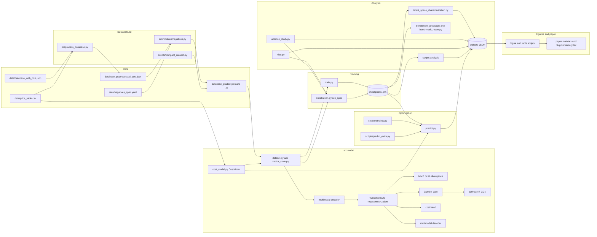

[](https://doi.org/10.5281/zenodo.24008094)
[](https://doi.org/10.5281/zenodo.24009092)

# Growth medium optimization in the MVRRAE_GV latent space

This repository holds the code, data and analysis behind a constrained optimization of xeno-free growth-medium recipes for mesenchymal stem cells. A rank-reducing variational autoencoder (MVRRAE_GV) encodes each recipe as a set of per-component latent codes, regularized by a signalling-pathway R-GCN whose readout nodes are proliferation, survival and differentiation. The negatives are graded: each recipe carries three targets (p, s, d) read from `data/negatives_spec.yaml` instead of one binary label. `CostModel` (`src/cost_model.py`) prices a recipe in USD/L from `data/price_table.csv`, and a cost head on the latent is trained against that price. `predict.py` minimizes the priced cost of the decoded recipe with an augmented Lagrangian. Readout, realism, osmolarity, ion, nutrient, protein-dose and vocabulary constraints are judged on the decoded, named and re-encoded recipe. The cost weight trades realism against cost.

## Repository layout

```
train.py                         single MVRRAE_GV training run, writes artifacts/mvrrae_gv__<tag>.pth
ablation_study.py                2^6 factorial ablation, run log and tables
hipo.py                          hyperparameter screen, refine, confirm and select
predict.py                       constrained latent optimization of the Wu base recipe
preprocess_database.py           embeds components and prices them
latent_space_characterization.py retrains four variants and measures latent geometry
benchmark_predict.py             predict-time cost evaluation of checkpoints
benchmark_recon.py               reconstruction usefulness of checkpoints
src/                             config, cost_model, constraints, ablation harness, benchmark, vector store
src/modules/                     model (mvrrae_gv, layers), dataset, graph, negatives, priors, featurization
scripts/                         run_*.sh launchers, analysis, figure and table scripts
  data_pipeline/                 raw recipes to database_with_cost.json: names to SMILES, embeddings, prices
tests/                           pytest suite (cost model, constraints, hand-edit guards)
data/                            recipes, price table, negatives spec, graph nodes, exclusions
artifacts/                       checkpoints, run logs, result JSON, figures
  optimizer/                     per-seed optimizer outputs (latent_raw, latent_anch, latent_prot, input)
  optimizer_sweeps/              anchor-strength and protein-floor sweeps
  ablation_analysis/             factorial, primaries, diagnostics and latent-curve JSON
  figures/                       ablation, latent and optimization figures
  recipes/                       best recipes extracted from the optimizer outputs
  legacy/                        outputs that predate the current dataset, kept for traceability
  original/                      the original authors' ablation log, read by scripts/ablation_factorial.py
  adr/                           internal decision records, backups and run notes
paper/                           main.tex, supplementaries/, figures, supp_refs.tex
```

Tracked: all source, `data/` except two generated files, result JSON, figures and `artifacts/adr`. Generated and gitignored (see `.gitignore`): checkpoints (`*.pth`), feature blobs (`*.pt`, `*.bin`, `*.pkl`), `data/database_preprocessed_cost.json`, `data/database_graded.json`, the merged `artifacts/ablation_runs.jsonl`, `artifacts/retrained/` and `artifacts/adr/logs/`. `data/per-protein.h5` is gitignored too. `artifacts/inputs.sha256` and `artifacts/datasets.sha256` list digests for the inputs and the generated datasets. `artifacts/checkpoints.sha256` lists digests for the ten deployed checkpoints and the four `mvrrae_gv__*` checkpoints.

## Code relationships



## Setup

The results were produced with Python 3.13.11 and torch 2.9.1+cu130 (CUDA 13.0) on a workstation with 32 cores, 30 GB RAM and one NVIDIA RTX 5060 Ti. Install the pinned packages with `pip install -r requirements.txt`. For the CUDA build of torch use the matching PyTorch wheel index.

```
export PYTHONPATH=.
```

Run every command from the repository root. `src/config.py` reads `GROWTHMEDIUM_ROOT` if the checkout is relocated. The device is CUDA when available and the CPU otherwise (`src/vae.py`). Seeds are set in code: `ablation.seed_everything(spec.seed)` for init, shuffling and sampling noise, `split_seed` 67 for the data split, and `SEED = 67` in `train.py`, `hipo.py`, `predict.py` and `latent_space_characterization.py`. The reported numbers come from the GPU. A CPU run follows the same code path and is not expected to match numerically, so `run_rerun.sh` and `run_extra.sh` refuse to start without CUDA.

## Reproduction

`scripts/reproduce.sh` has one subcommand per stage and echoes every command it runs. `data`, `train`, `latent` and `verify` execute. `ablation` prints the plan of the 9 hour rerun and runs the factorial analysis. `optimize` and `figures` print their commands and execute them only with `FULL=1`. Launchers are resumable and skip outputs that already validate. Everything below writes under `artifacts/` unless stated.

```
bash scripts/reproduce.sh data       # raw inputs, dataset rebuild into a temp dir, comparison (about 1 min)
bash scripts/reproduce.sh train      # seeds 0 to 9 into artifacts/retrained (about 19 min on the RTX 5060 Ti)
bash scripts/reproduce.sh ablation   # factorial analysis from the logs, plan of the full ablation rerun
bash scripts/reproduce.sh latent     # latent curves of the ten deployed checkpoints
bash scripts/reproduce.sh optimize   # optimizer commands for the ten checkpoints, FULL=1 to run
bash scripts/reproduce.sh figures    # figure commands, FULL=1 to run
bash scripts/reproduce.sh verify     # checksums, factorial.json byte check, retrained against deployed
```

Inputs. `artifacts/inputs.sha256` lists the raw inputs: the files in `data/`, `data/per-protein.h5`, `artifacts/qm9_gnn_encoder.pt`, `artifacts/qm9_gnn_embeddings.pt` and `artifacts/original/ablation_runs.jsonl`. The three large files are gitignored, so a fresh clone needs them copied in. Check them with `sha256sum -c artifacts/inputs.sha256` from the repository root. `artifacts/datasets.sha256` does the same for the generated dataset files and the stored statistics. `artifacts/original/ablation_runs.jsonl` is the authors' ablation log that `scripts/ablation_factorial.py --orig` reads.

1. Dataset (`reproduce.sh data`). `python preprocess_database.py --merged data/database_with_cost.json --out data/database_preprocessed_cost.json` embeds every component (ProtT5 for UniProt accessions, `MolecularRGCN` for PubChem SMILES) and rewrites `artifacts/component_prices.json`, `artifacts/cost_stats.pt` and `artifacts/scaling_stats.pt`. The stage runs it into a temp directory with all four outputs redirected, so the stored files stay untouched. The embeddings, the statistics and the prices match the stored ones. The JSON does not match byte for byte: the current script attaches the graded targets `p`, `s`, `d` and a `proliferation` of 0.15 to the negatives, and the stored file predates that. `python -m src.modules.negatives` writes `data/database_graded.json` from the stored `data/database_preprocessed_cost.json` and `data/negatives_spec.yaml`, and the result is byte identical to the stored one. Run on the rebuilt preprocessed file it gives a different graded set, so keep the stored preprocessed file as an input. `python scripts/compact_dataset.py --out <file> data/database_graded.json` writes the float32 sidecar `data/database_graded.pt`. Its contents match the stored sidecar and its bytes do not, because the torch archive header differs. `python scripts/rerun_tools.py fingerprint` prints the device, the dataset fingerprint and the record count, which the launchers compare with `EXPECTED_FP`. `python scripts/check_negatives.py` checks the graded set.
2. The ten deployed models (GPU). Each is the arm `selected` of `AblationSpec` with graded negatives, softmax readout, test fold 0, seed k from 0 to 9. `python scripts/train_selected.py --seed k --out-dir artifacts/retrained` trains one seed and `--all` trains all ten. The script builds the spec from the `src/config.py` defaults and stops if any field other than the seed differs from the deployed recipe, which it carries as a literal. It writes `ablation__selected__728320fe947b__s<k>__graded.pth` into `--out-dir` and refuses `artifacts/` itself. `python scripts/verify_retrained.py --retrained-dir artifacts/retrained` compares each retrained state_dict with the deployed one and recomputes the held-out reconstruction error, live latent directions, hole fraction and KS statistic from both. It exits 1 when a seed fails the rule in its docstring. Neither the original runs nor the script set a torch determinism flag, so GPU nondeterminism can make two runs of one seed differ. On this machine all ten seeds reproduced the deployed checkpoints bitwise, and seed 0 was trained twice. The measurements are in `artifacts/adr/logs/reproducibility_check.md`. The round-trip thresholds `artifacts/constraint_thresholds__<checkpoint stem>__roundtrip-v2.json` are fitted and cached the first time `predict.py` or the tests load a checkpoint, so run those on a checkpoint under `artifacts/` only. `python train.py` trains a single baseline model and writes `artifacts/mvrrae_gv__<tag>.pth`, where the tag is set by the `ABLATE_*` environment flags in `src/config.py`.
3. Hyperparameter sweep (GPU, not rerun in the verification). `bash scripts/run_hipo.sh` runs screen, refine and confirm in shards (fold 1, graded negatives, softmax readout) and writes `artifacts/hipo_{screen,refine,confirm,selection}.json`. The selection is not applied to `src/config.py`. `python hipo.py --select --help` lists the selection options and `--apply` writes the chosen coefficients.
4. Factorial ablation (GPU, not rerun in the verification). `bash scripts/run_rerun.sh` chains the sweep, the 64-arm ablation over folds 0 to 4 and seeds 0 and 1 (checkpoints are not saved), and the latent figures. `bash scripts/run_rerun.sh --dry-run` prints the plan. `WORKERS=3 bash scripts/run_ablation_checkpoints.sh` trains the baseline and six single-factor arms with checkpoints. `bash scripts/run_ablation_factorial.sh` is the per-fold variant. The merged log is `artifacts/ablation_runs.jsonl`. Analysis: `python scripts/ablation_factorial.py` writes `artifacts/ablation_analysis/factorial.json` and regenerates it byte for byte from `artifacts/original/ablation_runs.jsonl` and the run logs. `python scripts/ablation_primaries.py determinism|primaries|contrasts` writes the other files in that folder.
5. Latent characterization (GPU). `python scripts/latent_curves.py` reads the ten deployed checkpoints and rewrites `artifacts/ablation_analysis/latent_curves.json` with identical content. It also rewrites three figure PDFs under `artifacts/figures/ablation/`, whose bytes change. `python latent_space_characterization.py` retrains the four variants (MMD or KL, with or without SVD) and writes `artifacts/mvrrae_gv__*.pth`, `artifacts/latent_characterization.json`, `artifacts/latent_cluster_recipes.json` and figures in `artifacts/figures/`. `python scripts/latent_figures.py` does the same with figures in `artifacts/figures/latent/`. `python scripts/latent_figures_ckpt.py` and `python scripts/latent_ks_directions.py` read the stored checkpoints without training. `python scripts/diagnostics.py run` then `aggregate` read the ten deployed checkpoints. `python scripts/eval_readout.py <checkpoint> --out <json>` and `python scripts/readout_drift.py <checkpoint> --out <json>` evaluate one checkpoint.
6. Optimization (GPU, hours). Seed 0 was rerun from a retrained checkpoint and every numeric value matched the stored outputs except the per-run wall clock `seconds`. The comparison is recorded in `artifacts/adr/logs/reproducibility_check.md`. Seeds 1 to 9 were not rerun. For checkpoint k: `python predict.py --checkpoint artifacts/ablation__selected__728320fe947b__s<k>__graded.pth --sweep --out optimizer/latent_raw__s<k>.json` for the raw decode. Add `--decode anchored` for `latent_anch` and `--decode anchored --protect-proteins` for `latent_prot`. `--mode input --out optimizer/input__s<k>.json` scales the base recipe instead. The cost-weight grid, 20 multiplier updates and trust radius 0.3 are the defaults in `predict.py`. `reproduce.sh optimize` prints these commands for all ten seeds.
7. Sweeps (GPU, not rerun in the verification). `bash scripts/run_extra.sh --check`, then `python scripts/check_extra.py alpha1`, then `bash scripts/run_extra.sh` runs 140 sweeps of anchor strength and protein-floor scale through `scripts/predict_extra.py` into `artifacts/optimizer_sweeps/`. `bash scripts/run_extra.sh --dry-run` prints the plan.
8. Baselines. `python benchmark_predict.py "<checkpoint glob>" <out.json>` and `python benchmark_recon.py <out.json> <checkpoint> [more checkpoints]` score checkpoints. `bash scripts/run_predict_eval.sh` runs the former over the baseline and no_cost checkpoints.
9. Figures and numbers for the paper. `python scripts/ablation_factorial_figures.py` writes `artifacts/figures/ablation/`. `python scripts/figures_optimization_existing.py`, `python scripts/figures_optimization_main.py` and `python scripts/optimization_table.py` write `artifacts/figures/optimization/`. `python scripts/figures_sweep.py` writes into `paper/his_lsc` and `paper/supplementaries/sweep_criteria_table.tex`. `python scripts/paper_numbers_supp_pareto.py` prints the Pareto figures quoted in the supplement. The PDFs under `paper/ablation`, `paper/deployed_latent`, `paper/optimization` and `paper/his_lsc` are copies of the files in `artifacts/figures/`. `python scripts/supp_refs.py --write` regenerates `paper/supp_refs.tex`.

`scripts/diagnostics.py` imports four modules from inside the repository: `artifacts/adr/scripts/latent_geometry.py`, `artifacts/adr/scripts/latent_geometry_controls.py`, `artifacts/adr/scripts/recon_slot_metrics.py` and `artifacts/adr/priors/recovery_knowns.py`, which in turn imports `artifacts/adr/priors/priors.py`. All five are tracked. It also imports `benchmark_predict.py` and `predict.py` from the root.

Several scripts take no arguments and run when invoked, so `--help` is not a safe probe for them.

What was verified, on this machine. `reproduce.sh data`, `reproduce.sh verify` and `reproduce.sh ablation` ran to completion. `train_selected.py` ran for seeds 0 to 9 and `verify_retrained.py` passed on all ten. `latent_curves.py` and `ablation_factorial.py` reproduced their stored JSON. The optimizer for seed 0 was rerun from the retrained checkpoint and matched the stored outputs apart from wall clock seconds. The other stages, including the optimizer for seeds 1 to 9, were not rerun. `python predict.py` finds its artifacts directory through the `GROWTHMEDIUM_ROOT` environment variable (read in `src/config.py`) and refits the round-trip thresholds when they are absent, so a scratch root avoids touching the stored files.

## Verification

```
pip install pytest
python -m pytest tests
CHECKPOINT=artifacts/ablation__selected__728320fe947b__s0__graded.pth python -m pytest tests
```

Without `CHECKPOINT` the tests that need a loaded model are skipped, because the default checkpoint name is not in `artifacts/`. A run with a checkpoint refits the cached threshold file of that checkpoint, so `git status` may show it as modified.

```
python scripts/supp_refs.py --check
python scripts/ablation_factorial.py --out-json /tmp/factorial.json --out-md /tmp/factorial.md
cmp /tmp/factorial.json artifacts/ablation_analysis/factorial.json
cd artifacts && sha256sum -c checkpoints.sha256
```

`supp_refs.py --check` exits 1 when `paper/supp_refs.tex` is stale. The `cmp` command must report no difference. `bash scripts/reproduce.sh verify` runs these checks together with `scripts/verify_retrained.py`.

## Paper

LaTeX is not needed to run the code. To build the manuscript, run `pdflatex main.tex` twice in `paper/`. For the supplement, run `pdflatex Supplementary.tex` twice in `paper/supplementaries/`. `main.tex` carries its own `thebibliography`, so no bibtex step is needed.

## Data

`data/database_with_cost.json` holds the labelled recipes with per-component cost. `data/price_table.csv` is the reviewed unit-price table behind `CostModel`, and `data/manual_component_cost.csv` holds hand-entered prices. `data/negatives_spec.yaml` declares the priors used to grade the negatives. `data/graph_nodes_embedded.json` holds the pathway graph nodes, `data/nutrient_classes.json` the nutrient classes and `data/decode_exclusions.json` the decode exclusions. `data/database_preprocessed_cost.json`, `data/database_graded.json` and `data/database_graded.pt` are generated.

### Data pipeline

`scripts/data_pipeline/` holds the scripts upstream of `data/database_with_cost.json`. The order is raw recipes, names to SMILES or UniProt accessions (`01_names_to_smiles/`), embeddings (the root `preprocess_database.py`, with two one-off helpers in `02_embeddings/`), cost (`03_cost/`), then `python -m src.modules.negatives` for the graded set and `scripts/compact_dataset.py` for the float32 sidecar. `scripts/data_pipeline/README.md` has the details.

Reproduced here offline by `bash scripts/reproduce.sh data`: the embeddings, the scaling and cost statistics and the unit prices rebuilt from `data/database_with_cost.json`, and `data/database_graded.json` rebuilt byte for byte from `data/database_preprocessed_cost.json`. The rebuilt preprocessed JSON itself differs from the stored one, so that file stays an input. The other inputs are the raw recipes, the MongoDB export and the vendor prices. Stage 01 (PubChem and UniProt lookups) and the live Mcule and Chemspace price calls in `03_cost/` need network access, and the price calls need API keys. They are not run here and not run by `reproduce.sh`. Copy `.env.example` to `.env` and fill in the keys before running them. `.env` is not tracked. `data/price_table.csv` was recovered from the per-component costs in `data/database_with_cost.json` (its source column says so), apart from the rows that cite a URL, so the vendor quotes behind it are not in the repository.

## Authors

Arsha Permana Haryoko, Fadhil Daffa Putra Irawan, Nayaka Magani Bibisana, Muhammad Farid Akbar, Wahyu Widowati, Ahmad Faried, Mohammad Ikhsan and Rizal Azis, as listed in `paper/main.tex`. A citation entry will be added when the manuscript has a reference.

## Acknowledgements
AI tools (Claude, ChatGPT, and Gemini) were used to assist in writing scripts and refining language for this project. The authors independently reviewed and tested code and are solely responsible for data accuracy, analysis, and conclusions.
